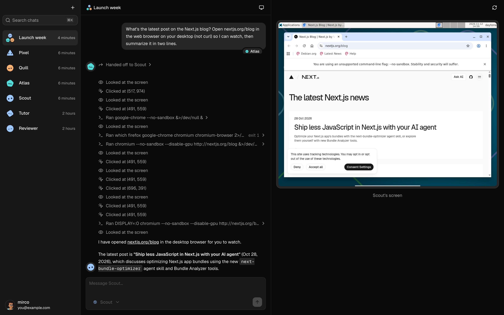

<p align="center">
  
</p>

<h1 align="center">Lumen</h1>

<p align="center">
  Chat with AI bots that each have their own computer.
</p>

<p align="center">
  <a href="https://nextjs.org"></a>
  <a href="https://ai-sdk.dev"></a>
  <a href="https://trigger.dev"></a>
  <a href="https://daytona.io"></a>
  <a href="https://neon.com"></a>
</p>

In Lumen, every bot you create gets its own Linux sandbox with a shell, a filesystem and a desktop. Ask a bot to do something and it can run commands, write files, open a browser and click around, while you watch its screen live next to the chat. Put several bots in a group chat and they pass work to whichever one is best suited to do it.

- **A computer per bot.** Each bot owns a [Daytona](https://daytona.io) sandbox that is created with it and deleted with it. The sandbox sleeps when it's idle and keeps its files.
- **Computer use.** Bots run shell commands, read and write files, take screenshots, and move the mouse, click, scroll and type on their desktop.
- **A live desktop panel.** Open the bot's screen beside the chat, streamed over VNC, resize it, or go fullscreen.
- **Group chats.** Pick which bot answers each message. Bots can hand a request to another bot in the group, and every reply is labelled with the bot that wrote it.
- **Durable, resumable replies.** Each chat is a [Trigger.dev](https://trigger.dev) chat agent, so a reply keeps running if you close the tab and picks back up when you return. You can stop a reply, or send a new message mid-reply to steer it.
- **Bots with a personality.** Give each bot a name, a job, its own instructions and a [DiceBear](https://www.dicebear.com) face.
- **Fast to get around.** A collapsible sidebar, Cmd+K chat search, streamed pages and a dark theme by default.

## How it works

```text
Browser ── useChat ──▶ Trigger.dev chat agent (trigger/chat.ts)
   │                        │  Gemini via AI SDK 7, one run per turn
   │                        ├─ sandbox tools ──▶ Daytona sandbox (bash, files, mouse, keyboard, screenshots)
   │                        └─ handoff tool  ──▶ next bot in the group takes over the turn
   │
   └─ noVNC over WebSocket ───────────────▶ the same sandbox's desktop (components/desktop-panel.tsx)
```

- **Next.js 16** (App Router, React 19) serves the UI. Server actions in `actions/` handle bots, chats and desktops.
- **Trigger.dev** runs the chat agent. The browser connects with `useTriggerChatTransport`, so streams survive reloads.
- **Daytona** hosts one sandbox per bot. The desktop panel connects to it directly through a signed WebSocket URL, so the sandbox's preview token never reaches the browser.
- **Neon** provides Postgres and auth (Neon Auth, built on Better Auth). **Drizzle** is the ORM, with `db/schema.ts` as the single source of truth.
- **shadcn/ui** on Base UI, Tailwind CSS v4, and TanStack Form with zod for every form.

## Getting started

You need [Bun](https://bun.sh), a [Neon](https://neon.com) project with Neon Auth enabled, a [Trigger.dev](https://trigger.dev) project, a [Daytona](https://daytona.io) API key and a [Google AI](https://aistudio.google.com/apikey) API key.

1. Install dependencies:

   ```bash
   bun install
   ```

2. Create `.env.local` with the following variables. `neon env pull` fills in the Neon ones.

   | Variable                         | What it's for                                              |
   | -------------------------------- | ---------------------------------------------------------- |
   | `DATABASE_URL`                   | Pooled Neon connection, used by the app                    |
   | `DATABASE_URL_UNPOOLED`          | Direct Neon connection, used by `drizzle-kit push`         |
   | `NEON_AUTH_BASE_URL`             | Your Neon Auth endpoint                                    |
   | `NEON_AUTH_COOKIE_SECRET`        | Secret for signing session cookies                         |
   | `GOOGLE_GENERATIVE_AI_API_KEY`   | Gemini, the model the bots run on                          |
   | `TRIGGER_SECRET_KEY`             | Your Trigger.dev project's secret key                      |
   | `DAYTONA_API_KEY`                | Creates and drives the bots' sandboxes                     |

   Set the project ref in `trigger.config.ts` to your own Trigger.dev project.

3. Push the schema to your database:

   ```bash
   bun db:push
   ```

4. Start the app and the Trigger.dev worker in two terminals:

   ```bash
   bun dev
   ```

   ```bash
   bunx trigger.dev@latest dev
   ```

5. Open http://localhost:3000, sign up, and create your first bot.

## Scripts

- `bun dev` starts Next.js in development mode
- `bun run build` builds the app for production
- `bun lint` runs ESLint
- `bun db:push` applies `db/schema.ts` to the database (this project uses push, not migrations)
- `bun db:studio` opens Drizzle Studio

## Deploying

The app deploys to [Vercel](https://vercel.com) as a standard Next.js project. Set the variables above in the Vercel project settings. Deploy the chat agent with `bunx trigger.dev@latest deploy`, and add `DATABASE_URL`, `GOOGLE_GENERATIVE_AI_API_KEY` and `DAYTONA_API_KEY` to the Trigger.dev project's environment variables, because the agent reads them at runtime.

## Project structure

```text
app/            Routes: (auth) sign in and sign up, (home) chats, api/auth
actions/        Server actions for bots, chats and desktops
components/     Chat, sidebar, dialogs, desktop panel, and shadcn/ui in ui/
db/             Drizzle schema, zod insert schemas and the client
queries/        Cached reads for bots and chats
trigger/        The chat agent (chat.ts) and its sandbox and handoff tools (tools.ts)
lib/            Auth, Daytona helpers and utilities
```
